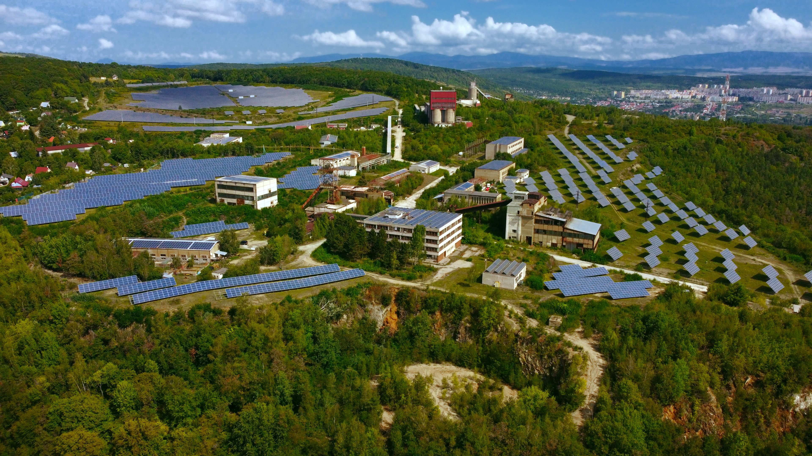

# FEW Solar

A modern, responsive website for a solar energy company in Pakistan — showcasing solar installation services, an instant solar system calculator, transparent packages & pricing, a net metering guide and completed projects.

**v2.0 — Rebuilt with React + Vite + Tailwind CSS** (component-based architecture; previously a single-file HTML page).

## 🔗 Live Demo
[View Live Site](https://few-solar-six.vercel.app/)

## 📌 About
FEW Solar is a client website built to establish an online presence for a solar energy business. It highlights the company's services, portfolio of completed solar installations, helps visitors estimate the right solar system for their home or business, and provides an easy way to request a quote.

## ✨ Features
- Fully responsive design (mobile, tablet, desktop) with an animated mobile menu
- **Instant Solar Calculator** — enter a monthly bill or units and get system size, panel count, roof area, monthly generation, savings and estimated cost
- **Packages & Pricing** — 3 kW / 5 kW / 10 kW systems with estimated prices
- **Net Metering guide** — the complete 5-step process explained
- Portfolio with category filters (Residential / Commercial / Agricultural / Industrial) and a scrollable carousel
- FAQ accordion, testimonials, and a quote-request form with success toast
- SEO & social-share meta tags

## 🛠️ Built With
- React 18 + Vite
- Tailwind CSS 3
- JavaScript (ES modules)
- Deployed via Netlify

## 📁 Project Structure
```
few-solar/
  index.html            # Vite entry + SEO/OG meta
  public/images/        # Static images
  src/
    main.jsx            # App entry
    App.jsx             # Page assembly
    index.css           # Tailwind + custom design system
    components/         # Header, Hero, Calculator, About, WhyChoose,
                        # Solutions, Packages, NetMetering, Portfolio,
                        # Testimonials, Faq, Contact, Footer
```

## ▶️ Run Locally
```bash
npm install
npm run dev      # development server
npm run build    # production build into dist/
npm run preview  # preview the production build
```

## 🚀 Deployment
Deployed via Netlify — build settings are included in `netlify.toml` (build command `npm run build`, publish directory `dist`).

## 📷 Preview


## 👨‍💻 Author
**Muhammad Aliyan**
Co-founder, D'zine
[LinkedIn](https://linkedin.com/in/muhammadaliyandev) | [GitHub](https://github.com/muhammadaliyandev)

## 📄 License
MIT — see [LICENSE](LICENSE).
